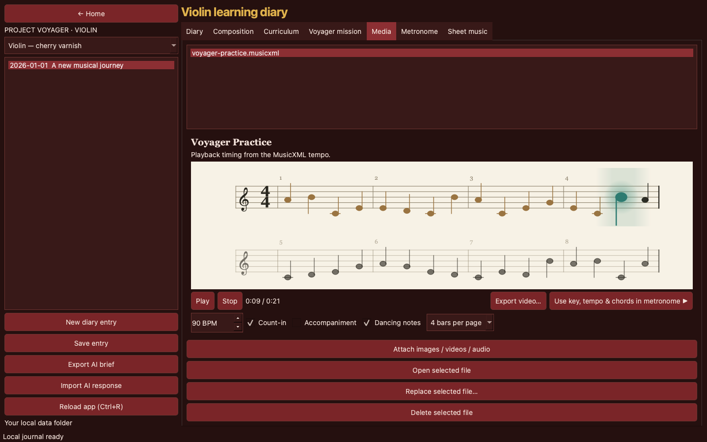
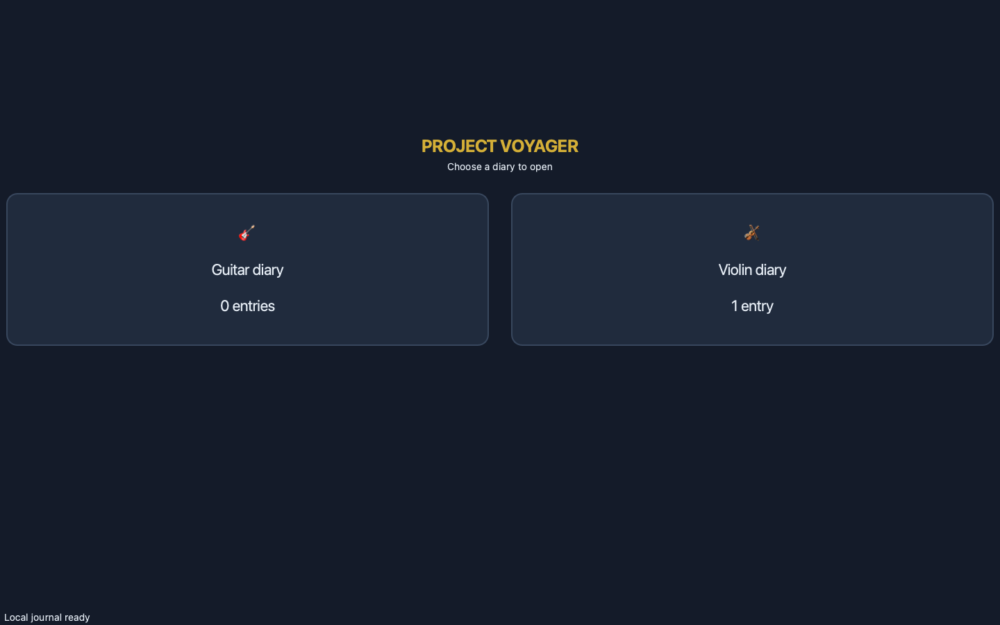

# Project Voyager

### Your music. Your journey. Your space to create.

From the first practice note to a new composition, **Project Voyager** brings
your guitar and violin journey together in one local desktop workspace. Capture
ideas, play along with a score, and find inspiration in the Voyager mission.

[Get started](#get-started) · [Explore the score player](#attach-and-play-a-score) · [Your data](#your-data-and-backups)



*Follow a score on a parchment-style staff, with the current note illuminated and
the next line coming into view.*

### Make every practice session count

🎵 **Play along** — Bring a MusicXML score to life with violin sounds, a
count-in, and optional accompaniment.

📓 **Capture your progress** — Keep practice notes, recordings, and
composition ideas together in your guitar or violin diary.

🚀 **Stay inspired** — Connect your music and learning to your own Voyager
mission notes, with room to grow at your pace.

🔒 **Keep it local** — Your journal and attachments stay on your computer;
optional AI collaboration is initiated by you.

> **Early version:** Voyager runs on your computer, not in a web browser. It
> currently requires Python to install and launch; there is no packaged installer
> yet.



*Choose an instrument and make the space your own. Screenshots use example
entries and an original practice melody.*

## What can I do?

| Your goal | Where to start |
|---|---|
| Record a practice session | Open the **Guitar** or **Violin** diary and create an entry. |
| Keep ideas and recordings together | Use the **Composition**, **Curriculum**, and **Media** tabs in an entry. |
| Practice with a beat | Open **Metronome** and choose a tempo, sound, and chords. |
| Play along with a score | Attach a MusicXML file in **Media**, then select it to open the score player. |
| Explore sheet music | In the violin diary, use **Sheet music** to scan text in a PDF or review chord suggestions. |
| Add a mission connection | Write in **Voyager mission** or add a locally saved video. |

## Get started

### What you need

- Python 3.10 or newer and a terminal.
- A copy of this project on your computer.
- An internet connection for the initial dependency installation. Regular use
  is local; no account or AI subscription is required.
- Optional: [FFmpeg](https://ffmpeg.org/) for exporting score videos.

### Install and open

Open Terminal on macOS/Linux or PowerShell on Windows, and change into the
Project Voyager folder. For example:

```sh
cd path/to/ProjectVoyager
```

**macOS / Linux:**

```sh
python3 -m venv .venv
source .venv/bin/activate
python -m pip install -r requirements.txt
python main.py
```

**Windows PowerShell:**

```powershell
py -m venv .venv
.\.venv\Scripts\Activate.ps1
python -m pip install -r requirements.txt
python main.py
```

The virtual environment (`.venv`) keeps the app's Python dependencies separate
from other projects. After the first installation, open a terminal in the
project folder, activate the environment using the command above, and run
`python main.py` to launch the app again.

## Your first practice entry

1. On the home screen, choose **Guitar** or **Violin**.
2. Select **New diary entry** and add a title and date.
3. Use **Diary** for notes and reflections. Add ideas in **Composition**,
   **Curriculum**, or **Voyager mission** if you wish.
4. Select **Save entry**. Edits also save when you navigate away or exit.
5. To return to the instrument selection, choose **← Home**.

Choose a theme from the sidebar; each diary remembers its own selection. On a
new database, Voyager adds a starter Am/E lesson to the guitar diary. Its date
is the first launch date, not a verified practice date.

## Attach and play a score

MusicXML is a file format that stores notes and other score information. It is
different from a PDF image of sheet music.

1. Open a diary entry and select **Media**.
2. Choose **Attach images / videos / audio** and select a MusicXML file
   (`.musicxml`, `.xml`, or `.mxl`).
3. Select the attached file in the list and press **Play**. Click the score to
   jump to a position.
4. Adjust the BPM or select **4 bars per page** or **8 bars per page** instead
   of scrolling. In page mode, the next line fades in during the last bar.

**Count-in** is on by default and gives one bar at 120 beats per minute (BPM).
The score then plays at its own tempo, unless you change the BPM control.
**Accompaniment**, off by default, adds locally generated percussion, bass, and
simple chords inferred from the score. These are practice suggestions, not the
original arrangement. **Dancing notes** adds a brief wobble as each note
starts; turn it off for a steadier view.

The sound uses bundled [VSCO 2 Community Edition](voyager/data/violin/README.md)
violin recordings. Notes explicitly marked staccato, staccatissimo, or spiccato
in MusicXML use short-bow samples; other notes use sustained samples. If a
needed sample is unavailable, the player falls back to sustained samples or a
synthesized tone.

You can also attach a MIDI file (`.mid` or `.midi`) alongside a MusicXML score.
Voyager uses the MIDI notes and timing for playback, preferably pairing files
with matching names. MusicXML articulation marks are not applied when MIDI
drives playback. The displayed notation is simplified: beams, multiple voices,
and ornaments are not shown.

Select **Use key, tempo & chords in metronome** to send the score's key, tempo,
and inferred per-bar chords to the metronome.

### Export a score video

Select **Export video…** in the score player to save an MP4 or a transparent
MOV overlay. The export includes the title, selected tempo, view, count-in,
accompaniment, and dancing-note setting. Install FFmpeg first; on macOS with
[Homebrew](https://brew.sh/), for example, use `brew install ffmpeg`.

## More practice tools

### Metronome

The **Metronome** tab plays a beat and chord progression at your chosen tempo
and time signature. Pick a pitched or percussion sound, and optionally add an
eighth-note shaker. The current beat and chord are highlighted. You can edit
the progression; Voyager also tries to read one from the entry's composition
text.

### PDF sheet music

In the violin diary, open **Sheet music** to attach and preview a PDF. **Scan
PDF text** looks for a key, time signature, tempo, and printed chord symbols in
the PDF's embedded text. It cannot read engraved notes or scanned images.
**Suggest chords from key** offers a simple I-IV-V progression when needed.
Review or edit the fields, then select **Use in metronome** to save and use
them. Chord suggestions are not a full harmonic analysis. For outside
analysis, use the sheet-music tab's **Export AI brief** and **Import AI
analysis** controls; review the returned fields before applying them.

### Media and Voyager videos

The **Media** tab holds local copies of attachments, including images, audio,
video, PDFs, and scores. Images preview in the app; supported videos play inline.
Use **Open selected file** to open other attachments in your computer's default
application. In **Voyager mission**, **Choose Voyager video…** adds a local
video to the entry.

### Optional AI collaboration

**Export AI brief** saves the selected entry as a JSON file. You can choose to
upload it and relevant media to an AI assistant; media are not embedded in the
brief. **Import AI response** validates a matching JSON response and asks for
confirmation before appending suggestions to the entry. Nothing is sent
automatically, and there is no automatic synchronization with ChatGPT Projects
or Pages. Share only information you are comfortable disclosing.

## Your data and backups

Your diary and attachments are stored locally in the application data folder
shown in the sidebar. To back up your work, **close Voyager and copy that
entire folder**, including the SQLite database and media. Keep the backup in a
safe location.

## For developers

- Run tests: `.venv/bin/python -m unittest discover -s tests -v`.
- Run `.venv/bin/python dev.py` to restart the app when `main.py` or
  `voyager/*.py` changes. In a normal run, **Reload app (Ctrl+R)** saves and
  relaunches the app.
- See [score-player design directions](docs/README.md),
  [requirements](REQUIREMENTS.md), and the [roadmap](ROADMAP.md).
