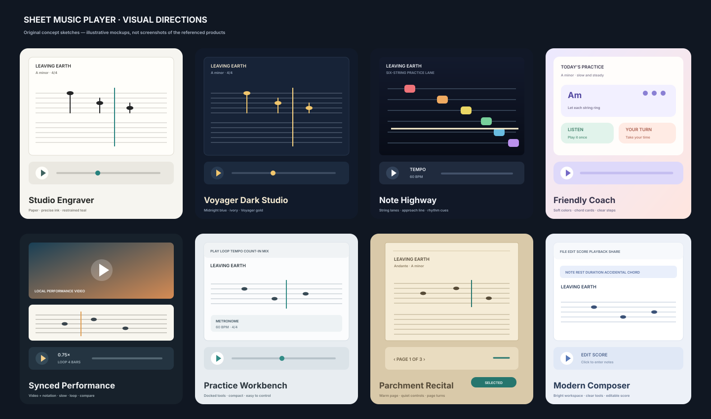

# Sheet Music Player: Theme Directions

The selected direction is **Parchment Recital with a Studio Engraver vibe**. The player uses a warm paper canvas, dark engraved-style notation, and restrained teal playback accents. The other directions remain available as future alternatives. These concepts are original, inspired by the products and references below, and do not reproduce another app.

Some choices are mainly **appearance themes**; others imply a different **player layout or learning mode**. The latter would take more than changing colors. The current score renderer paints several colors directly, so consistent palettes would need to reach the notation and metronome widgets as well as the app-wide Qt stylesheet.

The board is an original, illustrative mockup for comparing composition and hierarchy. It is not a screenshot of any referenced product; individual details can change when a direction is selected.

## Options

### 1. Studio Engraver — clear, traditional score

- **Look:** Warm white page (`#FAFAF7`), near-black notation, generous staff spacing, restrained teal or burgundy playhead; quiet, compact controls.
- **Feel:** A focused digital music stand. The score is the main event, with minimal interface chrome.
- **Best for:** Reading standard notation and longer, deliberate practice.
- **Trade-off:** Less immediately playful for beginners; requires very legible notation at different display sizes.
- **Direction type:** Mostly an appearance theme.

### 2. Voyager Dark Studio — calm, cinematic practice

- **Look:** Midnight blue/graphite surfaces, soft ivory notation, Voyager gold for the playhead and selected notes; controls sit in a clean, low-profile transport bar.
- **Feel:** Quiet and atmospheric, with a clear focus line and limited motion.
- **Best for:** A cohesive fit with Voyager’s existing studio aesthetic and reduced screen glare.
- **Trade-off:** Gold must remain an accent rather than carry essential meaning; contrast and color-blind readability need deliberate checks.
- **Direction type:** Mostly an appearance theme; closest to the existing visual identity.

### 3. Note Highway — playful, rhythm-forward learning

- **Look:** Dark stage, six string lanes with distinct but coordinated colors, a strong “play now” line, and large upcoming-note cues.
- **Feel:** Energetic and game-like, with gentle success feedback rather than punitive error flashes.
- **Best for:** Quick orientation to timing, strings, and frets.
- **Trade-off:** A highway is a different visualization from conventional staff notation; it should complement, not silently replace, the score-reading view.
- **Direction type:** A distinct learning mode, not just a palette.

### 4. Friendly Coach — approachable beginner view

- **Look:** Soft indigo, sea-glass, and warm coral accents; roomy cards for chord names and short phrases; larger labels and simplified controls.
- **Feel:** Encouraging, uncluttered, and easy to scan during a first practice session.
- **Best for:** Learners who find a full score intimidating or need a chord-first entry point.
- **Trade-off:** Too much simplification can hide useful notation and playback detail from developing readers.
- **Direction type:** A simplified player layout with an appearance theme.

### 5. Synced Performance — score beside a performance

- **Look:** A real performance video or waveform shares the window with notation; the active note is highlighted, with visible speed and loop controls.
- **Feel:** Observe, listen, slow down, repeat a passage, and compare what is heard with what is written.
- **Best for:** Learning phrasing and timing from a performance, and studying an existing recording.
- **Trade-off:** A video/score split needs more space and reliable synchronization. It should not imply online playback; Voyager remains local-first unless that product scope changes.
- **Direction type:** A player layout and workflow, not just a palette.

### 6. Practice Workbench — compact tools for focused sessions

- **Look:** Neutral score surface with a tidy, docked control strip for tempo, count-in, loop, and metronome; optional compact panels for other practice tools.
- **Feel:** Practical and precise, with controls close at hand and the notation kept readable.
- **Best for:** Learners who regularly adjust tempo, repeat bars, or switch between practice tools.
- **Trade-off:** Persistent panels can crowd the score. Keep secondary tools collapsible and avoid turning the player into a dashboard.
- **Direction type:** A denser layout; it can be paired with Studio Engraver or Voyager Dark Studio colors.

### 7. Parchment Recital — paper-like reading (selected)

- **Look:** Warm paper paired with Studio Engraver's dark notation, roomy staff spacing, and restrained teal playhead; controls remain compact.
- **Feel:** A digital recital stand; page turns and hands-free controls are more prominent than a scrolling playhead.
- **Best for:** Page-based scores and uninterrupted performance.
- **Trade-off:** Page metaphors work poorly with continuous scrolling and can reduce available space for playback controls.
- **Direction type:** Appearance theme applied to the existing scrolling and paged score player; page-turn gestures remain a possible future feature.

### 8. Modern Composer — clean, editable workspace

- **Look:** Bright neutral canvas, one confident blue/indigo accent, clear toolbars, and distinct boundaries between score and editing controls.
- **Feel:** Organized and productive, emphasizing composition and score editing over theatrical playback.
- **Best for:** A future workflow centered on composing, arranging, and revising notation.
- **Trade-off:** An editor-like interface can feel less immersive for practice; collaboration and editing tools are beyond the current player's scope.
- **Direction type:** A broader product/workspace direction, not merely a player skin.

## Quick comparison

| Direction | Primary strength | Main compromise | Scope |
|---|---|---|---|
| Studio Engraver | Readable, familiar notation | Less playful | Appearance |
| Voyager Dark Studio | Fits Voyager’s identity | Needs careful contrast | Appearance |
| Note Highway | Immediate rhythm/fret cues | Separate visualization from notation | Learning mode |
| Friendly Coach | Welcoming for beginners | Can hide detail | Layout + appearance |
| Synced Performance | Connects notation to real playing | Sync and screen-space complexity | Layout + workflow |
| Practice Workbench | Efficient controls | Risk of clutter | Layout |
| Parchment Recital | Natural page-reading metaphor | Less suited to scrolling | Layout + appearance |
| Modern Composer | Supports editing and composition | Broader scope than playback | Workspace |

## References

These are visual/product references only. The concepts above synthesize patterns; they do not prescribe copying any product's interface.

- **MuseScore 4:** [Scoring Notes review](https://www.scoringnotes.com/reviews/musescore-4-0/) describes its light/dark themes, accent colors, customizable toolbars, and redesigned mixer.
- **Rocksmith+:** [Ubisoft art-and-design diary](https://www.ubisoft.com/en-us/game/rocksmith/plus/news-updates/jRUcL6HEPsWB07OFwIg5F/rocksmith-dev-diary-july-2022-art-design) discusses customizable guitar visuals, lighting, and the Noteway. See also the [official YouTube walkthrough of look customization](https://www.youtube.com/watch?v=TjnHjL3cMBc).
- **Soundslice:** Its [player features](https://www.soundslice.com/features/) show synchronized notation and performance, click-to-seek, tempo changes, looping, and visual fretboards. The [official YouTube channel](https://www.youtube.com/channel/UCS2wFslbGwri2XNqKtDwBnw) includes notation-editor demonstrations.
- **Songsterr:** The [Songsterr web app walkthrough on YouTube](https://www.youtube.com/watch?v=qMuS05KfTJE) is a reference for a compact tab player and controls.
- **Synthesia:** Its [official product site](https://synthesia.app/) describes the optional falling-note view alongside sheet music and practice modes.
- **forScore:** [Basics documentation](https://forscore.co/documentation/basics/) describes paper-oriented page navigation, hidden controls, display modes, and sepia effects.
- **Flat:** [Interface documentation](https://help.flat.io/en/music-notation-software/discover-the-interface/) illustrates a clean notation workspace with toolbars and touch-friendly note input.

## Choosing a direction

Pick one primary direction, then optionally name a secondary influence (for example, **Voyager Dark Studio with Studio Engraver notation**). It is also reasonable to keep the visual theme separate from player modes, so users can choose dark or light colors without being forced into a highway, video layout, or page-turn workflow.
